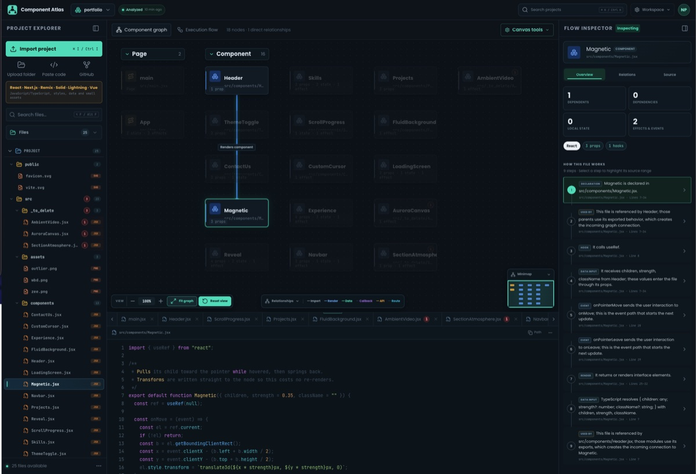
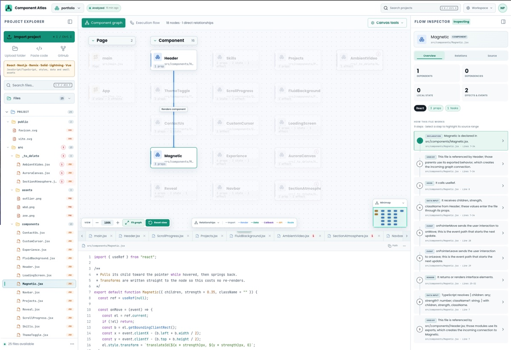
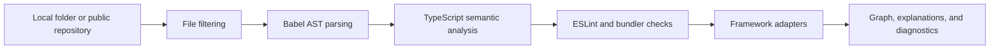

<p align="center">
  
</p>

<h1 align="center">Component Atlas</h1>

<p align="center"><strong>Understand any codebase before you touch a line.</strong></p>

<p align="center">
  Component Atlas turns a modern frontend project into an interactive map of its components, dependencies, data flow, routes, diagnostics, and connected source code.
</p>

<p align="center">
  
  
  
  
  
</p>

<p align="center">
  <a href="#-getting-started">Getting started</a> ·
  <a href="#-how-analysis-works">How it works</a> ·
  <a href="#-features">Features</a> ·
  <a href="#-deployment">Deployment</a>
</p>



## Why Component Atlas?

Large frontend projects are difficult to understand from a file tree alone. Imports reveal only part of the story: props move through components, hooks manage state, callbacks travel upward, routes connect screens, and API calls cross several layers.

Component Atlas makes those relationships visible. Select a file to see what it receives, what it sends, why it is connected, and the exact source lines behind each relationship.

> Component Atlas performs static analysis. Imported applications are not executed and their dependencies are not installed.

## ✨ Features

### Explore the architecture

- Interactive component and dependency graph
- Focused relationships for the currently selected file
- Component graph and execution-flow views
- Directional, typed edges for imports, renders, data, callbacks, APIs, and routes
- Infinite canvas with zoom, pan, fit, reset, minimap, grouping, and depth controls

### Understand the code

- Plain-language file purpose and behavior summaries
- Connected execution steps linked to exact source ranges
- Incoming and outgoing relationship explanations
- Props, hooks, state, events, exports, and framework details
- Change-impact information for dependent files

### Inspect the source

- Directory-style project explorer
- Syntax-highlighted JavaScript, JSX, TypeScript, and TSX
- Unlimited closable and scrollable code tabs
- Search, word wrap, font controls, line highlighting, and diagnostics
- Read-only project source so analysis never modifies imported files

### Manage projects

- Import local folders and public GitHub repositories
- Analyze an isolated code snippet for quick experiments
- Save multiple projects per signed-in user
- Rename, favorite, reanalyze, compare, export, and remove projects
- Restore the most recently opened workspace across sessions
- Cloud-safe project metadata synchronization with Firestore

### Diagnose problems

- TypeScript semantic diagnostics
- ESLint findings
- Parser and unresolved-import errors
- Dependency cycles and unused-file findings
- Searchable project-health report grouped by file and severity
- Import report explaining every ignored file

## 🖼️ Light and dark workspaces

| Dark theme | Light theme |
| --- | --- |
|  |  |

Both themes preserve graph categories, diagnostics, code highlighting, and inspector hierarchy. The analysis workspace is currently optimized for desktop screens.

## 🧠 How analysis works

Analysis runs in a Web Worker so parsing and relationship discovery do not block the interface.



| Engine | What it contributes |
| --- | --- |
| Babel parser and traversal | JavaScript, JSX, TypeScript, and TSX syntax trees |
| TypeScript compiler APIs | Symbols, aliases, exports, references, types, and semantic diagnostics |
| ESLint browser runtime | Static correctness and maintainability findings |
| Framework adapters | Routes, layouts, components, hooks, and framework-specific behavior |
| Bundler inspection | Vite and Webpack aliases, dynamic imports, and connected resources |
| Relationship engine | Render, data, callback, API, route, import, and resource edges |

Unchanged file facts are cached between analyses. Large projects use file and byte budgets to protect browser responsiveness, and active analysis can be cancelled safely.

## Supported frameworks

| Framework | Current support |
| --- | --- |
| React | Components, props, hooks, state, events, renders, imports, and resources |
| Next.js | App Router, Pages Router, layouts, routes, client/server boundaries, and framework APIs |
| Remix | Routes, components, loaders, actions, and imports |
| SolidJS / SolidStart | Components, signals, effects, routes, and relationships |
| LightningJS | Components and framework relationships |
| Vue / Nuxt | Components, composables, routes, and imports |
| Astro | Pages, components, scripts, and imports |

React and Next.js currently provide the deepest analysis. Other framework adapters are actively evolving.

## Supported inputs

| Input | Best for |
| --- | --- |
| Local folder | Complete analysis of a project on your device |
| Public GitHub repository | Exploring an open-source project without downloading it first |
| Code snippet | Quickly examining one component or a small example |

Snippet analysis is intentionally secondary because missing files limit project-wide relationship discovery. Private GitHub repositories are not supported yet.

## 🔒 Privacy and safety

- Analysis runs locally in the browser.
- Imported application code is never executed.
- Project dependencies are never installed.
- Local and pasted private source is not uploaded to Firestore.
- Firestore stores cloud-safe workspace and analysis metadata for signed-in users.
- Public GitHub source is fetched only for the repository being analyzed.
- Generated output, dependency folders, secrets, lock files, oversized binaries, and unsupported files are ignored.

Review the Firebase configuration and Firestore rules before deploying your own public instance.

## 🚀 Getting started

### Requirements

- Node.js `22.13.0` or newer
- npm
- A modern desktop browser with Web Worker and ES module support

### Install

```bash
git clone https://github.com/nikpathak9/Component-Atlas.git
cd Component-Atlas
npm install
cp .env.example .env.local
```

Add your Firebase web configuration to `.env.local`:

```env
VITE_FIREBASE_API_KEY=
VITE_FIREBASE_AUTH_DOMAIN=
VITE_FIREBASE_PROJECT_ID=
VITE_FIREBASE_STORAGE_BUCKET=
VITE_FIREBASE_MESSAGING_SENDER_ID=
VITE_FIREBASE_APP_ID=
```

Start the development server:

```bash
npm run dev
```

Open the local URL shown by Vite. To use the intended Node version with `nvm`:

```bash
nvm install 22
nvm use 22
```

## Firebase setup

1. Create a Firebase project and web application.
2. Enable **Google** and **Email/Password** in Firebase Authentication.
3. Create a Firestore database.
4. Add the six Firebase web values to `.env.local`.
5. Review and deploy the included [`firestore.rules`](./firestore.rules).

```bash
firebase deploy --only firestore:rules
```

## Available commands

| Command | Purpose |
| --- | --- |
| `npm run dev` | Start the Vite development server |
| `npm run build` | Create a production build in `dist/` |
| `npm run start` | Preview the production build |
| `npm run test` | Run the production-build verification command |
| `npm run test:analyzer` | Run analyzer and framework regression tests |
| `npm run lint` | Run ESLint across the repository |

## Project structure

```text
app/
├── analyzer/              # Web Worker and static-analysis engines
├── components/
│   ├── auth/              # Shared authentication UI
│   ├── code/              # Syntax-highlighted code rendering
│   ├── landing/           # Landing-page sections and product preview
│   ├── ui/                # Shared dialog and interface primitives
│   └── workspace/         # Explorer, graph, code panel, and inspector
├── firebase/              # Authentication and Firestore synchronization
├── hooks/                 # Reusable interface behavior
├── lib/                   # File classification and shared utilities
├── login/                 # Sign-in route
├── signup/                # Account creation route
├── stores/                # Zustand UI and editor state
├── types/                 # Workspace and analyzer types
├── workspace/             # Workspace route
└── page.tsx               # Application orchestration
public/
├── previews/              # README and landing-page screenshots
└── component-atlas-logo.*
tests/                     # Analyzer and framework regression tests
firestore.rules            # Firestore access rules
netlify.toml               # Netlify build and SPA routing configuration
```

## 🌐 Deployment

The repository includes [`netlify.toml`](./netlify.toml). When importing the repository into Netlify, use:

- **Build command:** `npm run build`
- **Publish directory:** `dist`
- **Node version:** `22`

Add all six `VITE_FIREBASE_*` values under **Project configuration → Environment variables**. Do not commit `.env.local`.

For Google authentication, add the deployed Netlify domain to Firebase Authentication's **Authorized domains**. The SPA redirect supports direct visits to `/workspace`, `/login`, and `/signup`.

## Current limitations

- The analysis workspace is restricted to desktop screens.
- Private GitHub repository import is not available.
- Static analysis cannot guarantee runtime behavior or visual correctness.
- Local project edits are not written back to the original files.
- Cloud synchronization stores analysis metadata rather than private local source.
- Very large repositories are constrained by browser-safe file and byte budgets.
- Framework coverage outside React and Next.js is still expanding.

## Roadmap

- Isolated editable playground with static validation and graph updates
- Deeper cross-file prop, state, callback, route, and API-flow analysis
- Private GitHub import using minimal server-side OAuth permissions
- Virtualized project trees and diagnostic lists
- More graph layout work moved off the main UI thread
- Expanded end-to-end, accessibility, and framework regression coverage

## Development status

Component Atlas is under active development. The analyzer test suite covers AST relationships, aliases, resources, TypeScript semantics, ESLint findings, bundler behavior, framework routes, source locations, caching, progress reporting, and cancellation.

## License

No open-source license has been added yet. All rights are reserved by the repository owner unless a license is introduced later.
